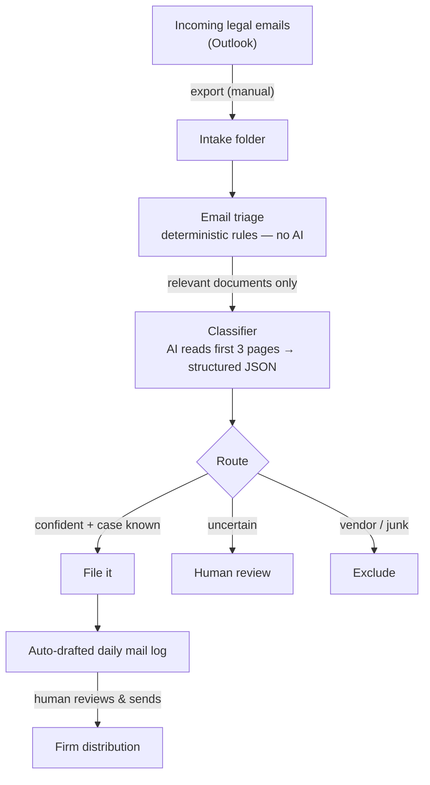

# Legal Document Intake Pipeline

An AI-assisted pipeline that automates incoming-document intake for a litigation
practice: it reads each legal document, classifies it by the firm's rules, names
it to the firm's convention, flags possible deadlines for human review, and
auto-drafts the daily mail-log email — with a human approving everything before
anything is filed or sent.

> **About this repository.** This is a **sanitized, self-contained demo** of a
> system I designed and run in daily production at a plaintiff-side litigation
> firm. The production version is private and confidential. **No firm data,
> client data, or production code appears here** — every case, party, and
> document in this repo is fictional, and the demo classifies with local rules
> instead of a cloud API so it runs with zero dependencies and nothing leaves
> your machine.

## The problem

A trial firm receives a large volume of legal mail every day — pleadings,
discovery, orders, correspondence, medical records — and each document creates
different obligations (calendaring, routing, attorney review). Identifying the
real documents, renaming them to a strict convention, sorting them, and sending
a firmwide daily mail log is accurate, repetitive work that took about **an hour
a day** by hand. A single misfile or missed deadline is expensive.

## What it does



> A richer, color-coded version of this diagram — showing what runs locally vs. the
> single external call — is in [`docs/architecture.html`](docs/architecture.html)
> (open it in a browser).

1. **Eligibility gate** — every document is first sorted INCLUDE / EXCLUDE /
   REVIEW, so vendor receipts and confirmations never reach the mail log and
   anything ambiguous goes to a person.
2. **Classification** — document type, the case it belongs to, and a
   house-style filename (`YYYY.MM.DD Case - Description.pdf`).
3. **Routing** — *file it*, *needs human review*, or *exclude*.
4. **Mail log** — an auto-drafted daily summary, grouped by case, in the firm's
   format — which the human reviews and sends.

## Design decisions I'm proud of

- **Rulebook as configuration, not code.** The firm's entire rulebook (naming
  convention, abbreviation glossary, case table, category codes, eligibility
  rules) lives in a versioned document that *is* the classifier's instructions.
  The rules can change without touching the software.
- **Deterministic gate before the expensive AI.** Plain rules discard junk
  *before* any paid API call — AI is used only where real judgment is needed.
- **Order-sensitive classification.** Rules are most-specific-first, so
  "Motion to Compel … Interrogatories" is a *Motion*, not *Interrogatories*,
  and "Answer to Complaint" is an *Answer*, not a *Complaint*. (The demo
  encodes this; try reordering the rules and watch it misfile.)
- **Human-in-the-loop by design.** Nothing is sent, filed, or deleted
  automatically. Deadlines are only ever **flagged** for human verification,
  never auto-calendared. When the system is unsure, the document goes to a
  person — it is never silently dropped.
- **Built to survive production.** The real system runs documents in parallel,
  times out and retries failed calls, routes any failure to human review (one
  bad document can't freeze a batch), and keeps an original-to-renamed audit
  trail for every run.

## Run the demo

Requires only Python 3 — no dependencies, no network, no API key.

```bash
python3 demo.py
```

Sample output:

```
  Legal document intake — demo run
  ------------------------------------------------------
  [FILE   ] scan001.pdf      Motion to Compel
             → 2026.03.12 Nguyen - Mtn to Compel.pdf
  [FILE   ] Document(3).pdf  Deposition Notice
             → 2026.03.12 Chen - Depo Ntc.pdf
  [EXCLUDE] receipt.pdf      Document
  [FILE   ] mo_cmc.pdf       Minute Order
             → 2026.03.11 Ramirez - Min Order.pdf
  [FILE   ] ltr.pdf          Correspondence
             → 2026.03.10 Diaz - Ltr.pdf
  [REVIEW ] scan_0412.pdf    Document
  [FILE   ] ans.pdf          Answer
             → 2026.03.08 Harper - Answer.pdf  (case derived from caption — spot-check)

  DRAFT MAIL LOG — <today's date>

  Chen
       •  2026.03.12 Chen - Depo Ntc
  Diaz
       •  2026.03.10 Diaz - Ltr
  (… remaining cases grouped the same way …)

  8 documents → 6 filed, 1 for review, 1 excluded.
```

## How this was built

I'm a senior litigation paralegal, not a trained software engineer. I owned the
**design and domain logic** — the business problem, the firm's naming and
eligibility rules, the safety decisions (bias-to-review, deadlines-stay-flags,
no auto-delete), and the testing — and I used **AI pair-programming (Claude)**
to write and debug the implementation, which I directed, reviewed, and validated
on real batches over several months in production.

The reported "about an hour a day down to roughly five minutes" is my
operational estimate, not a formal benchmark.

## Tech

Python 3 · standard library only (this demo) · the production system adds the
Anthropic Claude API for classification and `pypdf` for PDF handling.

## License

MIT — see [LICENSE](LICENSE).
